# Negotiated-Time BTS Formation Control for Six UAVs in RflySim/PX4 HIL

This repository contains the research code for a six-UAV negotiated-time bounded-time synchronized (BTS) formation-control experiment. The implementation targets a USB hardware-in-the-loop (HIL) workflow using RflySim, CopterSim, RflySim3D/UE4, and external PX4-compatible flight controllers.

## RflySim / UE4 Hardware-in-the-Loop Overview

RflySim connects simulated vehicle dynamics with physical flight controllers. In this project, CopterSim runs the vehicle model and exchanges simulated sensor data and actuator commands with external PX4 flight controllers. RflySim3D, based on Unreal Engine 4 (UE4), visualizes the resulting vehicle poses and environment.

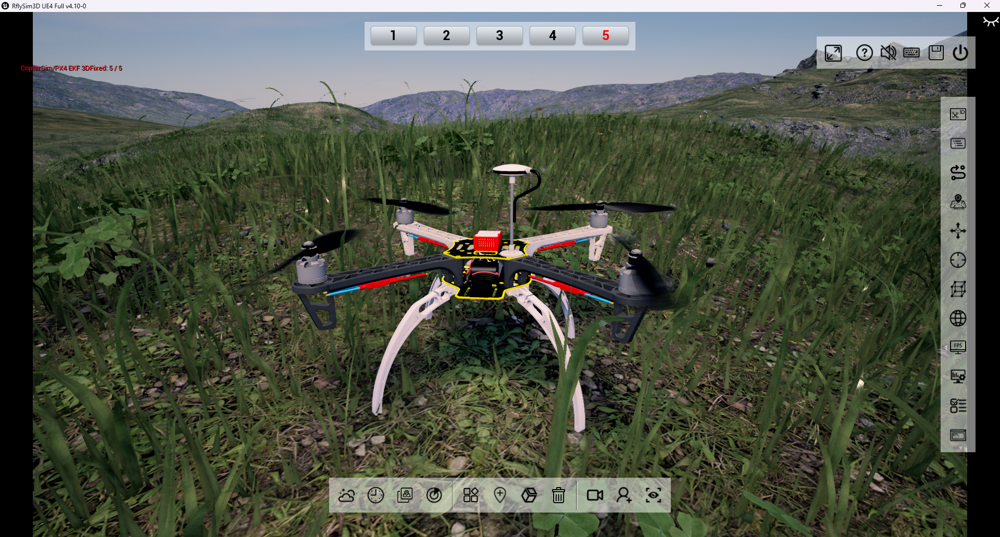

*Close-up of the simulated vehicle and terrain in RflySim3D / UE4.*

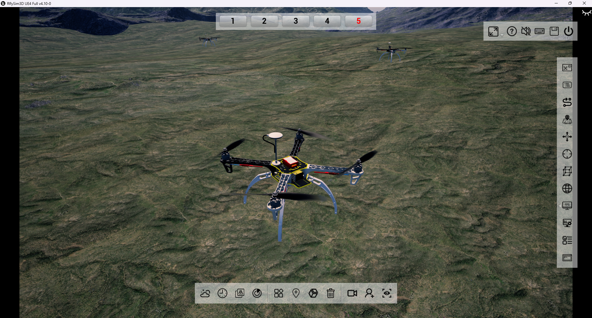

*Multiple UAVs displayed in a shared UE4 scene. Both screenshots show the visualization environment used to present the simulated vehicles.*

The HIL loop combines three components:

1. **CopterSim** updates the simulated vehicle motion and supplies sensor measurements to the flight-controller hardware.
2. **Physical PX4 flight controllers** execute the onboard control software and return actuator commands to the simulator, closing the feedback loop.
3. **RflySim3D / UE4** displays vehicle motion in the virtual environment, while QGroundControl provides monitoring and configuration.

The repository's BTS controller runs on the host computer and sends attitude and thrust commands to PX4. The hardware bench and system diagram below show how these components are connected for the six-UAV experiment. See the [RflySim toolchain overview](https://rflysim.com/doc/en/1/CoreAppIntro.html) and [CopterSim documentation](https://rflysim.com/doc/en/3.Soft/coptersim.html) for platform details.

### UDP Communication in This Implementation

The host-side Python controller connects to six CopterSim/PX4 endpoints through the RflySim `PX4MavCtrlV4` SDK. Each vehicle has its own ID and UDP endpoint. The launch template selects `Mavlink_Full`, and the controller starts the matching MAVLink receive loop with `InitMavLoop()`. MAVLink defines the control and telemetry messages, while UDP transports those messages between the host-side applications.

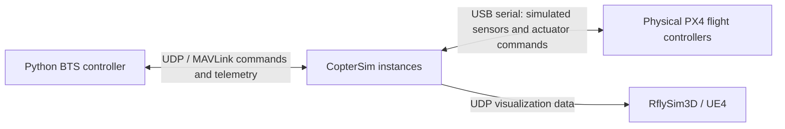

| Communication path | Information exchanged | Role |
| --- | --- | --- |
| Python controller and CopterSim/PX4 endpoints | Vehicle state feedback and desired attitude/thrust commands | Runs the BTS outer-loop controller |
| CopterSim and physical PX4 controllers | Simulated sensor measurements and actuator commands over USB serial | Closes the hardware-in-the-loop feedback loop |
| CopterSim and RflySim3D / UE4 | Vehicle pose updates over the visualization interface | Displays the simulated vehicle motion |

**Vehicle addressing.** The default controller address is `127.0.0.1`, with vehicle IDs 1 through 6. In the installed SDK, the default base port is `20100 + 2 * (vehicle_ID - 1)`, and the controller receives telemetry on the following port. For example, UAV 1 uses the 20100/20101 pair and UAV 6 uses 20110/20111. MAVLink replies use the peer endpoint learned by the receive connection. Match the SDK, simulator mode, IDs, IP settings, and port allocation when configuring a different installation.

**Control cycle.** At a default outer-loop rate of 50 Hz, the script reads the latest received vehicle states, computes the BTS commands, and calls `SendAttPX4()` to update the desired attitude quaternion and normalized thrust for each vehicle. The SDK handles MAVLink reception and command transmission in its background loops, so the 50 Hz control setting does not specify the rate of every UDP stream.

**Neighbor information.** The six-node ring describes which neighbors enter the control and time-negotiation calculations. In this released HIL script, all six agents are evaluated in one host process, with neighbor quantities accessed in memory. The UDP links connect that process to the simulation endpoints rather than implementing six separate inter-agent network processes.

Implementation details are available in the [controller](scripts/six_circle_bts_wind_px4_att_thrust.py) and [HIL launch template](examples/START_HITL_EXAMPLE.bat).

The released code focuses on the controller, trajectory plotting, and sanitized launch templates. It does not include RflySim, PX4 firmware, CopterSim, QGroundControl, binary logs, raw screenshot collections, or hardware-specific private configuration. Selected experiment images are included in `docs/images` for documentation.

To run the complete HIL workflow, a full local RflySim/PX4PSP environment must already be installed and configured. This repository is not a standalone simulator package. It must be used together with RflySim, CopterSim, RflySim3D/UE4, QGroundControl, the RflySim Python SDK, and the required external PX4-compatible flight controllers.

## Experiment at a Glance

The images below show the six-UAV HIL workflow, from the physical flight-controller bench and UE4 visualization to the recorded formation and attitude responses. The UAVs and terrain shown in UE4 are simulated, while the flight controllers shown in the hardware photograph are physical devices.

### RflySim3D / UE4 Interface

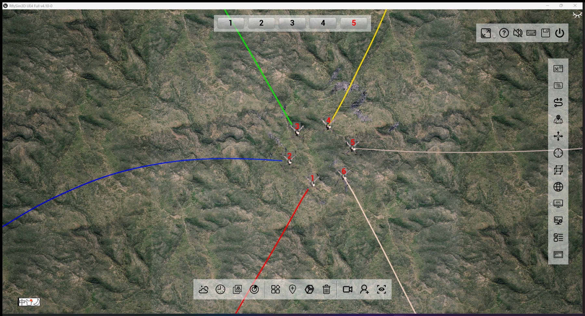

*Original UE4 interface capture with the visualization controls and colored UAV trajectory trails.*

### Physical Hardware and System Architecture

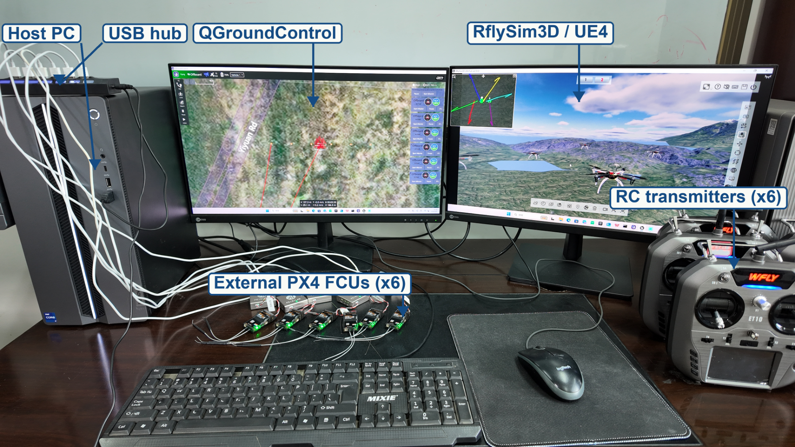

*Photograph of the HIL test bench. The labels identify the host PC, USB hub, six external PX4 flight controllers, RC transmitters, QGroundControl, and UE4 display.*

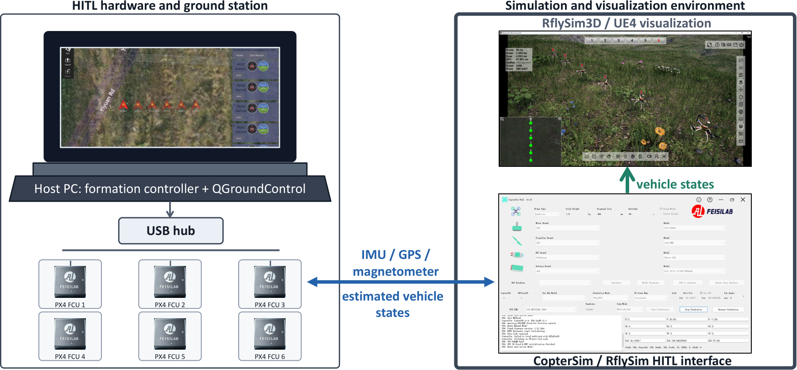

*Hardware, ground station, simulation, and visualization components of the experimental system.*

### Formation Evolution in UE4

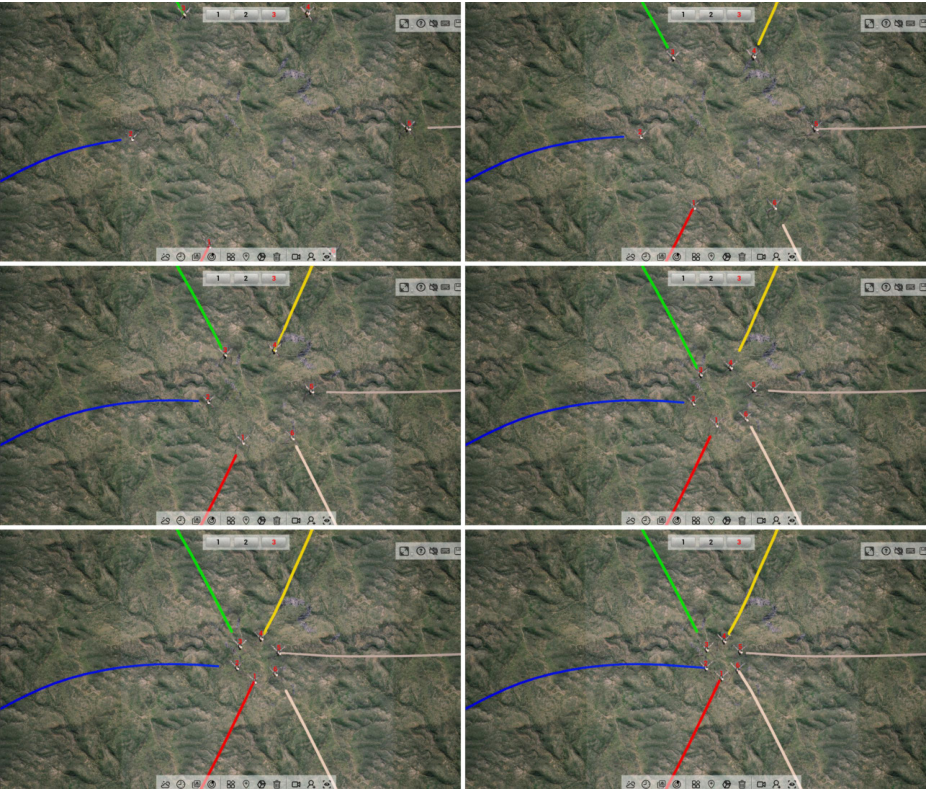

*Successive visualization snapshots from the six-UAV HIL experiment with wind disturbance.*

### Trajectories and Formation Geometry

| Three-dimensional formation snapshots | Horizontal-plane trajectories |
| :---: | :---: |
| 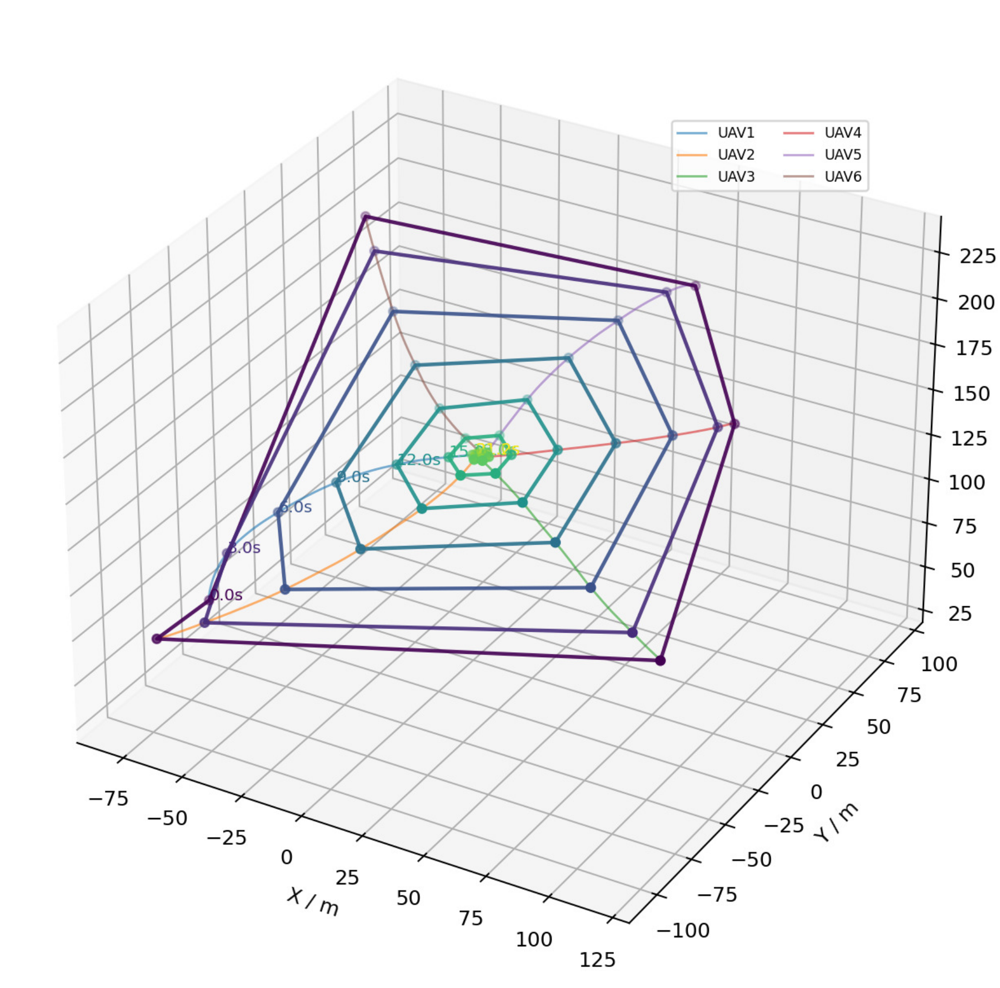 | 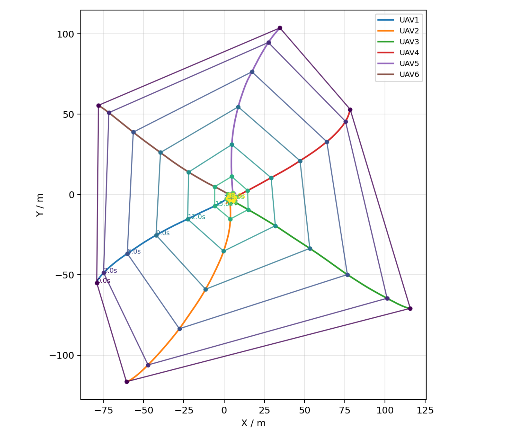 |

*The connected polygons join the six UAV positions at selected instants and illustrate the evolution of the formation geometry.*

### Position and Attitude Responses

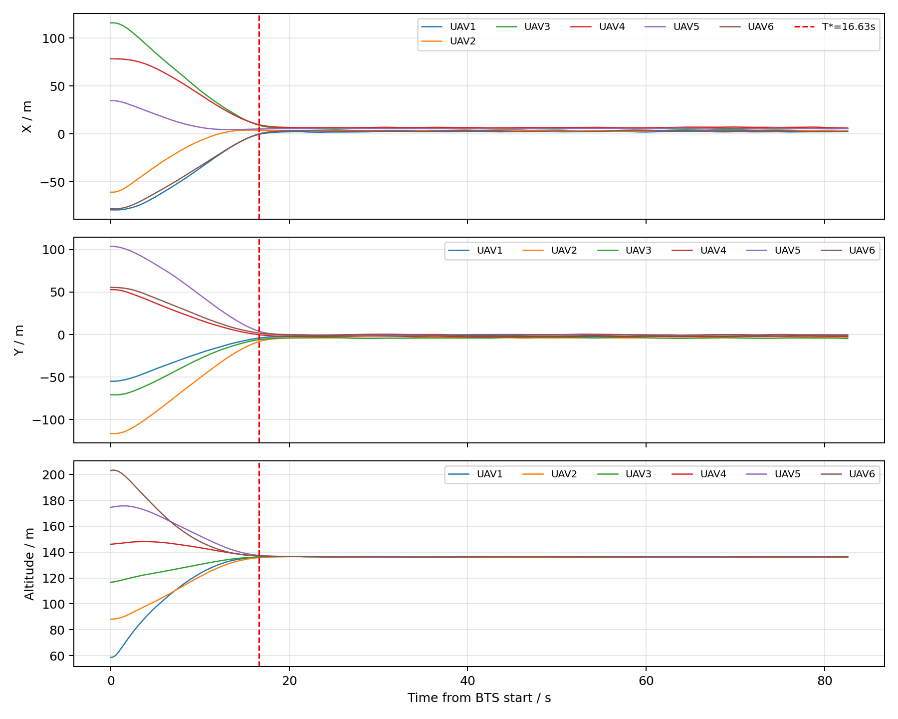

*Logged x, y, and z position responses. The marked negotiated time provides a common reference for the formation maneuver.*

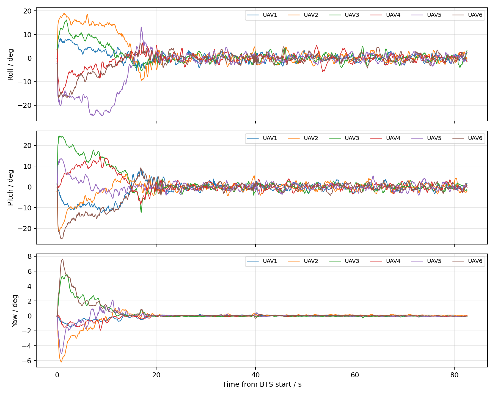

*PX4 roll, pitch, and yaw responses under the BTS outer-loop controller.*

These are archived experimental illustrations, not a newly generated run of the released code. See [image provenance](docs/images/README.md) for the source of each image and [the figure guide](docs/LOG_FIGURE_GUIDE.md) for the logged quantities.

## What Is Included

See `INTERFACE_SPEC.md` for controller inputs/outputs, launch-script interfaces, and CSV log fields.

```text
scripts/six_circle_bts_wind_px4_att_thrust.py
```

Six-UAV distributed BTS formation controller. It computes desired acceleration from neighbor-state errors, maps acceleration to PX4 attitude quaternion and normalized thrust commands, and sends commands through the RflySim PX4 MAVLink control API.

```text
scripts/plot_six_circle_trajectory.py
```

Post-processing script for CSV logs. It generates 3D trajectories, XY trajectories, XYZ position curves, equivalent BTS state curves, distributed time-consensus curves, formation error curves, and attitude response curves.

```text
examples/RUN_CONTROLLER_EXAMPLE.bat
examples/START_HITL_EXAMPLE.bat
```

Sanitized example Windows launch scripts. They are templates and must be adjusted to the local RflySim installation and hardware setup.

```text
docs/LOG_FIGURE_GUIDE.md
```

Explanation of generated log figures.

## Dependencies

Complete experiment execution requires a full RflySim/PX4PSP installation. The scripts in this repository provide the BTS controller and plotting workflow, but they rely on the local RflySim runtime to start CopterSim, RflySim3D/UE4, QGroundControl, MAVLink communication, and the USB HIL hardware interface.

The controller depends on the RflySim Python SDK:

```text
RflySimSDK/ctrl/PX4MavCtrlV4.py
```

Typical local layout:

```text
C:\PX4PSP\RflySimAPIs\RflySimSDK
```

Python packages used for plotting:

```text
matplotlib
```

The HIL experiment also requires:

```text
RflySim
CopterSim
RflySim3D/UE4
QGroundControl
Six external PX4-compatible flight controllers
```

## Controller Summary

The released controller uses a second-order outer-loop formation model. For UAV `i`, the shifted formation state is

```text
q_i = p_i - d_i
```

where `p_i` is the UAV position and `d_i` is the assigned regular-hexagon formation offset. Consensus of `q_i` yields a formation:

```text
p_i = c + d_i
```

The communication graph is an undirected six-node ring:

```text
1 -- 2 -- 3 -- 4 -- 5 -- 6 -- 1
```

The controller computes a BTS acceleration command and maps it to a PX4 attitude quaternion and normalized thrust. PX4 still handles attitude/rate control, motor mixing, and low-level execution.

## Dynamic Time Negotiation

The controller can use dynamic distributed time negotiation. Each UAV estimates a local time state from its initial shifted-state disagreement and exchanges time states over the same ring topology. The resulting negotiated time is then used by the BTS controller.

Manual timing is retained only for debugging.

## Wind Disturbance

The released code includes an equivalent wind-acceleration disturbance for controller-level robustness testing. It combines band-limited stochastic turbulence and randomly triggered one-cosine gusts. This is not a direct modification of CopterSim's internal aerodynamic wind field.

## Basic Usage

1. Install and configure the complete RflySim/PX4PSP environment locally.
2. Connect the required PX4-compatible flight controllers.
3. Start QGroundControl, RflySim3D, and CopterSim instances using a local launch script.
4. Run the controller template:

```bat
examples\RUN_CONTROLLER_EXAMPLE.bat
```

5. After the controller exits, generated logs and figures will be saved under `logs\run_YYYYMMDD_HHMMSS`.

## Notes Before Publishing

Before pushing to a public repository:

1. Choose and add a real open-source license.
2. Remove private local logs, uncurated screenshots, raw experiment videos, and private hardware serial/COM mappings. Keep the selected documentation images in `docs/images`.
3. Confirm whether the RflySim SDK files can be redistributed. This package does not redistribute them.
4. Replace any institution-specific paths, coordinates, or hardware IDs with user-editable placeholders.
5. Add citation information for the corresponding paper.
